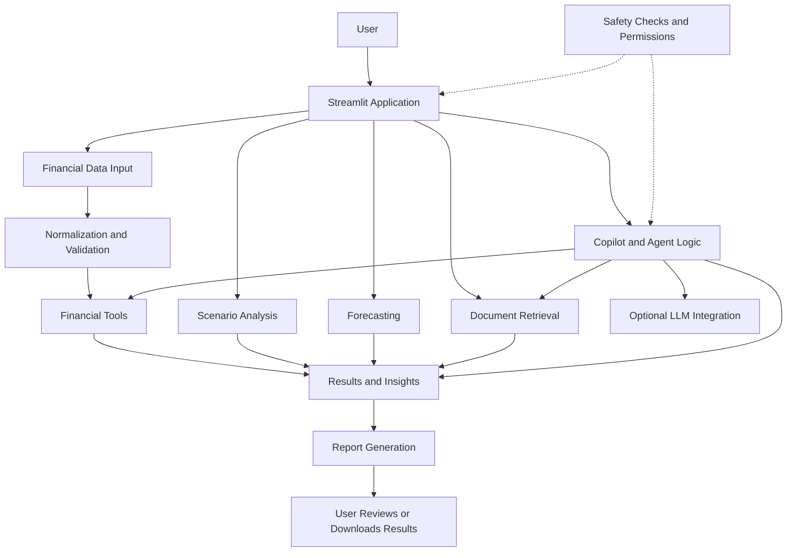

# FinMatrix Copilot — System Architecture

Team Name: FinMatrixDUO
Project: FinMatrix Copilot
Competition: Shenzhen FinTechathon 2026 — International Track
Theme: AI as a Financial Participant

## 1. Overview

FinMatrix Copilot is a Streamlit-based financial decision-support application designed to help small and medium-sized businesses work with financial data more easily.

We developed the application to bring financial analysis, scenario calculations, forecasting, document retrieval, and AI-assisted financial queries into one workspace. The aim is to help users understand their financial information, explore possible outcomes, and make better-informed decisions.

The application combines Python-based financial logic with optional AI assistance. Financial calculations and generated explanations serve different purposes, so users should review the underlying figures and assumptions before relying on any result.

## 2. System Architecture

FinMatrix Copilot uses a modular Python architecture with Streamlit as its user interface. The main application coordinates user interactions, while separate modules handle financial calculations, data preparation, forecasting, retrieval, safety checks, and reporting.

This structure keeps the main application organized and allows individual components to be maintained and evaluated separately.

### Architecture Diagram

*The diagram shows the main architectural components. The exact execution path depends on the user's selected workflow and the application's configuration.*

## 3. Main Components

| Component | Purpose |
|---|---|
| `app.py` | Provides the Streamlit interface, navigation, data upload, dashboard, scenario analysis, forecasting interface, policy search, guardrail audit, and report export. |
| `src/normalization.py` | Prepares and normalizes financial data for supported workflows. |
| `src/financial_tools.py` | Contains deterministic financial calculations and risk-related helper functions. |
| `src/forecasting.py` | Handles the configured forecasting implementation. Predictions should only be displayed when valid results are available. |
| `src/retrieval.py` | Searches the configured local document collection for potentially relevant information. |
| `src/copilot.py` | Coordinates supported Copilot workflows and related application functionality. |
| `src/agent.py` | Contains agent-related logic for supported task handling and tool interactions. |
| `src/llm_client.py` | Provides optional language-model integration, depending on provider configuration and availability. |
| `src/safety.py` | Implements selected input-pattern checks and action-permission checks. |
| `src/evaluation_engine.py` | Provides forecasting evaluation and invoice-evaluation helpers. |
| `src/report_generator.py` | Generates downloadable reports from supported application results. |
| `notebooks/` | Contains exploratory analysis, validation experiments, and retrieval or guardrail evaluation workflows. |
| `tests/` | Contains automated regression tests for implemented functionality and selected edge cases. |

## 4. Application Workflow

The application follows a sequence of data preparation, analysis, interpretation, and review.

1. **Data input:** The user uploads financial records or uses data available through a supported workflow.
2. **Data preparation:** The application normalizes and validates available fields before processing.
3. **Financial calculations:** Python-based financial tools calculate supported summaries, indicators, and scenario results.
4. **Forecasting:** The configured forecasting component is used when the necessary model and inputs are available. If predictions cannot be produced, the application should communicate the limitation instead of presenting invented results.
5. **Document retrieval:** Policy-related queries search the configured document collection for potentially relevant information.
6. **Copilot assistance:** Supported questions may use application logic, financial tools, document retrieval, and an optional configured language model.
7. **Result review:** Users review the available figures, explanations, assumptions, and limitations.
8. **Report export:** Supported results can be exported through the report-generation workflow.

Not every workflow uses every component. The steps involved depend on the task being performed.

## 5. Financial Calculations and Scenario Analysis

FinMatrix Copilot uses deterministic Python functions for supported financial calculations rather than relying exclusively on a language model to produce numerical results.

This approach makes the calculation logic easier to inspect and test. However, a calculation can still be incorrect or misleading when its inputs, units, assumptions, or source records are inaccurate.

Scenario analysis allows users to explore the effects of changing supported assumptions. The results represent the scenarios entered into the application; they are not guarantees of future business performance.

## 6. Forecasting

The forecasting component is responsible for producing predictions through the configured implementation.

Forecasts should only be presented when the required inputs are available and the model returns valid results. If the model is unavailable or fails, the application should display an appropriate error or unavailable state.

Forecasts are estimates rather than guaranteed outcomes. Their usefulness depends on data quality, the evaluation method, and whether the underlying data adequately represents the situation being analyzed.

## 7. Document Retrieval and AI Assistance

The retrieval component searches the configured local document collection to find information that may help answer a user's question.

The Copilot can use supported application logic and, when configured, an external language model to assist with interpreting questions or explaining results.

These components have different responsibilities:

- **Financial tools** perform supported calculations.
- **Document retrieval** finds potentially relevant source material.
- **The language model** can help interpret questions and generate explanations.
- **The user** reviews the results before making consequential financial decisions.

Retrieved passages may be incomplete, irrelevant, or insufficient to support a conclusion. Language-model responses may also be inaccurate. Where source information is available, users should inspect it rather than treating a generated answer as verified fact.

External AI functionality depends on valid provider configuration, service availability, and applicable usage limits. The application should not imply that an external model successfully generated a response when the request failed.

## 8. Safety and Data Handling

Because financial information can be sensitive, the application needs appropriate input validation, error handling, and protection of credentials and user data.

The current safety-related module includes selected input-pattern detection and action-permission checks. These mechanisms are limited safeguards and should not be treated as comprehensive security controls.

Important considerations include:

- Validate uploaded files and required fields before processing.
- Handle missing, inconsistent, or incorrectly formatted values explicitly.
- Keep API keys and other credentials outside committed source code.
- Treat uploaded documents and retrieved text as untrusted input.
- Avoid exposing sensitive information in error messages and logs.
- Ensure that any protected action is authorized where such functionality is available.
- Review data retention and session isolation before handling real business records.

Pattern-based checks alone cannot prevent every malicious input, prompt injection, unauthorized action, or financial-data error.

## 9. Evaluation and Testing

We use automated tests and evaluation workflows to examine implemented behavior and reduce regressions during development.

The project includes test and evaluation areas for financial calculations, data handling, forecasting, retrieval, guardrails, and other supported application features.

Forecasting evaluation should respect chronological ordering where appropriate, so that information from future observations does not leak into training or evaluation of earlier periods.

Evaluation results must be interpreted alongside the dataset, assumptions, test procedures, and limitations. Passing automated tests does not establish that the application is free from errors or ready for unrestricted production use.

## 10. Technology Stack

The project uses the following technologies where applicable to the implemented workflows:

- **Python** for application logic and financial calculations.
- **Streamlit** for the user interface.
- **Pandas and NumPy** for data processing and numerical operations.
- **Pytest** for automated testing.
- **Jupyter notebooks** for exploratory analysis and evaluation.
- **A configurable language-model integration** for optional AI-assisted functionality.
- **Local document retrieval** for searching the configured document collection.

The project's dependency list and configuration files define the packages and settings required by the current implementation.

## 11. Deployment Considerations

FinMatrix Copilot is built as a Streamlit application. Before making it publicly accessible or using it with sensitive financial records, the deployment should be reviewed for:

- Authentication and authorization.
- Secret and API-key management.
- File-upload validation and resource limits.
- Session isolation and access to financial records.
- Data retention, privacy, and logging.
- External model-provider failures and data-handling policies.
- Dependency maintenance and error handling.
- Appropriate security testing and operational monitoring.

A working prototype should not automatically be considered production-ready. These controls need to be assessed against the actual implementation and hosting environment.

## 12. Current Scope and Limitations

FinMatrix Copilot is a financial decision-support prototype. It is not a banking platform, a complete accounting system, a regulated credit-decision authority, or a substitute for qualified financial or legal advice.

The quality of its outputs depends on the input data, implemented calculations, available models, configured documents, and runtime environment. Synthetic or demonstration data should be clearly distinguished from real business records.

The application is intended to help users understand financial information and explore possible outcomes. Users remain responsible for reviewing the results and making their own decisions.

## 13. Future Development

Potential areas for further development include:

- Broader evaluation using independently sourced financial datasets.
- Improved retrieval relevance and source-grounding evaluation.
- Additional checks for financial calculation accuracy and forecasting assumptions.
- Stronger authentication, authorization, and deployment security.
- Clearer explanations of uncertainty and data quality.
- Usability improvements based on feedback from intended users.

These are potential development directions and should not be interpreted as completed features.

---

**Project:** FinMatrix Copilot  
**Focus:** AI-assisted SME financial analysis and decision support  
**Competition:** Shenzhen FinTechathon 2026 — International Track
